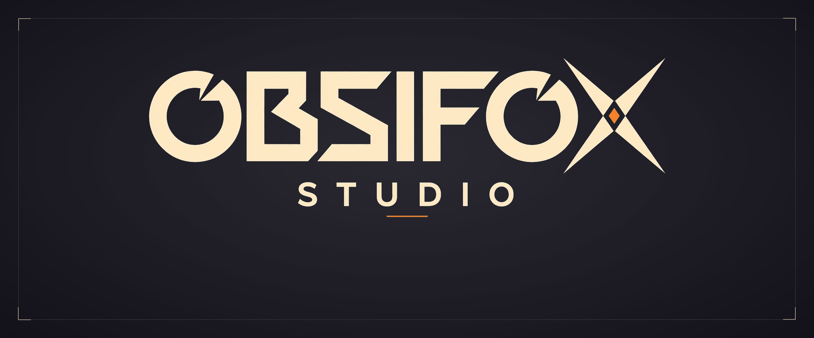
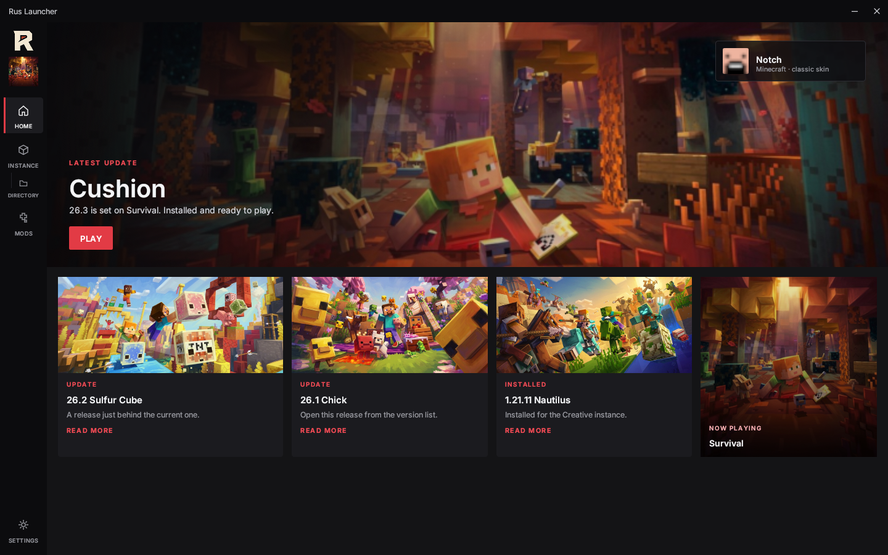
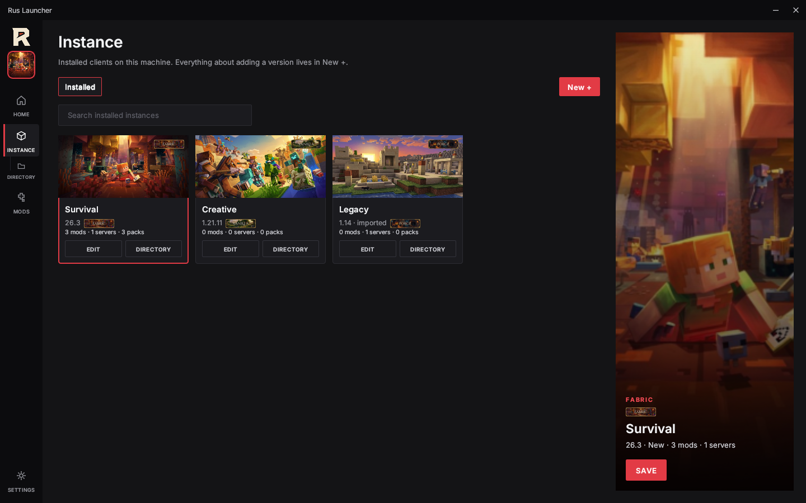
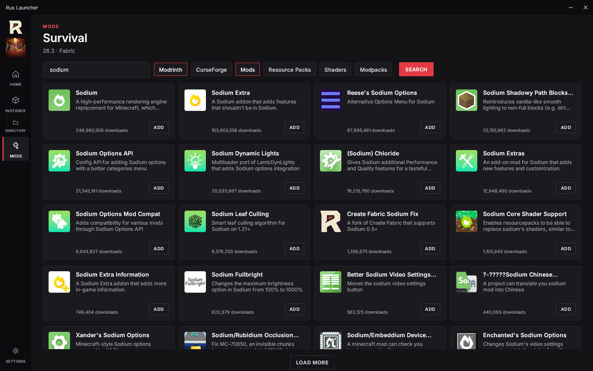
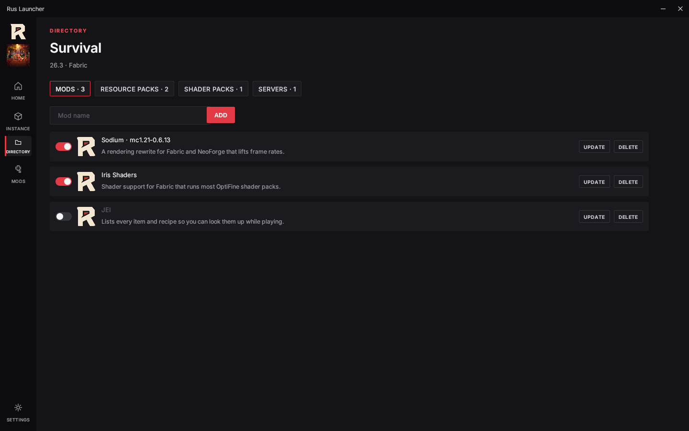
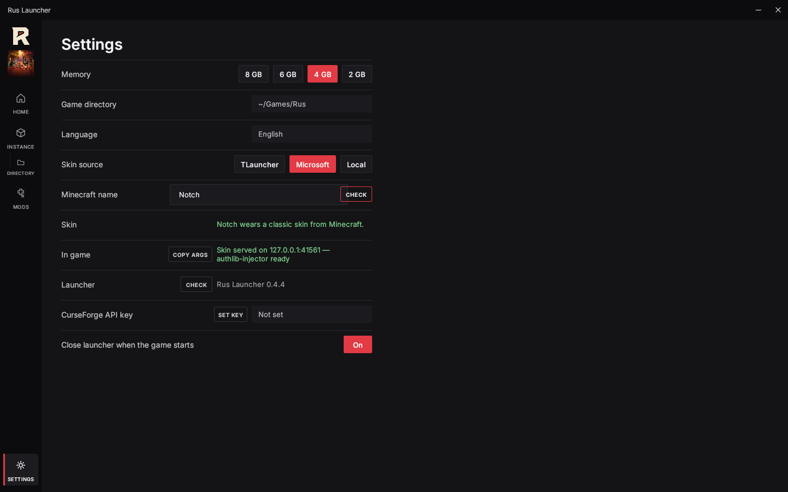
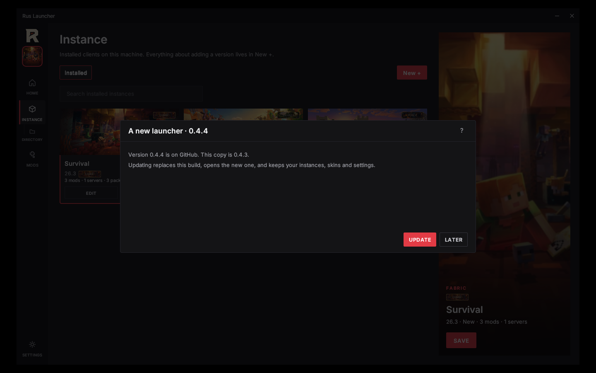

  

<h1 align="center">Obsifox Studio</h1>

  A game studio. 
  Built with intent. Kept clear. Made to be played.

 

<table>
  <tr>
    <td align="center" width="33%">
      <b>Craft</b> 
      Every line is intentional.
    </td>
    <td align="center" width="33%">
      <b>Clarity</b> 
      Nothing extra on the page.
    </td>
    <td align="center" width="33%">
      <b>Play</b> 
      Made to be used, not only seen.
    </td>
  </tr>
</table>

 

<h2 align="center">Rus Launcher</h2>

  The studio's public project. This page is its home. 
  <a href="https://github.com/obsifox/rus-launcher">github.com/obsifox/rus-launcher</a>

## Screens

<table>
  <tr>
    <td align="center" width="50%">
       
      <b>Home</b> — what is new, and the skin you wear
    </td>
    <td align="center" width="50%">
       
      <b>Instances</b> — every client on this machine
    </td>
  </tr>
  <tr>
    <td align="center" width="50%">
       
      <b>Mods</b> — Modrinth and CurseForge, in one search
    </td>
    <td align="center" width="50%">
       
      <b>Directory</b> — what one instance has installed
    </td>
  </tr>
  <tr>
    <td align="center" width="50%">
       
      <b>Settings</b> — where the skin comes from, and how it reaches the game
    </td>
    <td align="center" width="50%">
       
      <b>Updates</b> — the launcher asks GitHub, then replaces itself
    </td>
  </tr>
</table>

 

  Obsifox Studio · Syne

